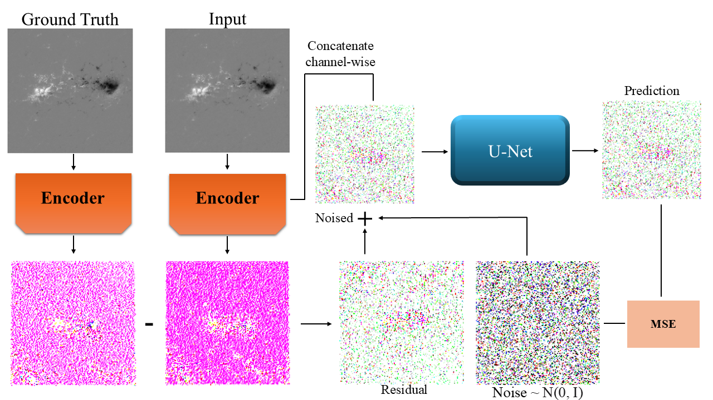
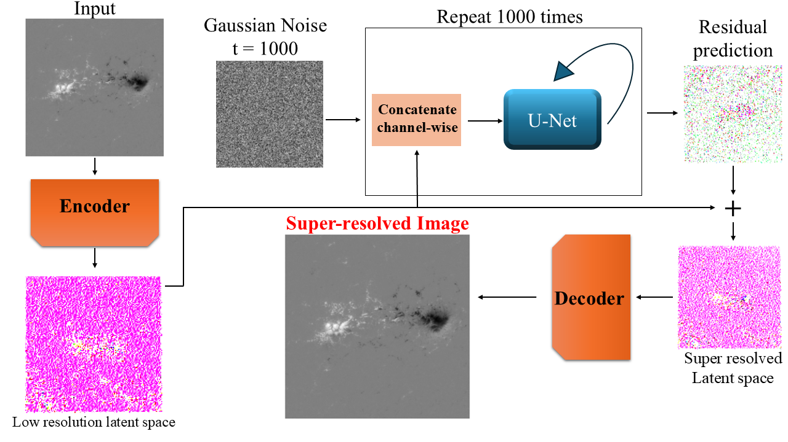
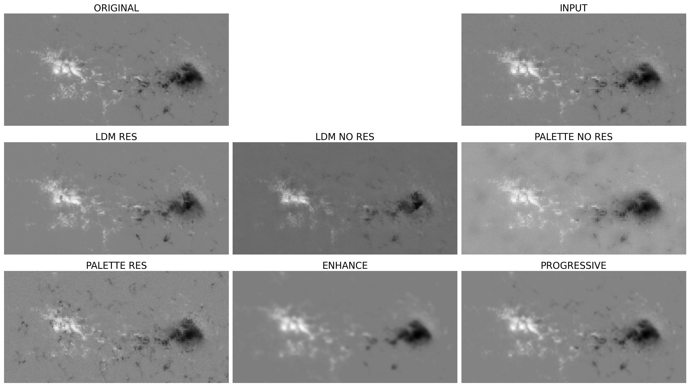
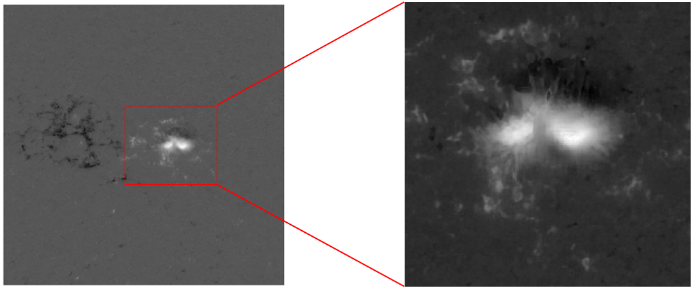

The spatial properties of the solar magnetic field are crucial to decoding the physical processes in the solar interior and their interplanetary effects. However, observations from older instruments, such as the Michelson Doppler Imager (MDI), have limited spatial or temporal resolution, which hinders the ability to study small-scale solar features in detail. Super-resolving these older datasets is essential for uniform analysis across different solar cycles, enabling better characterization of solar flares, active regions, and magnetic network dynamics. In this work, we introduce a novel diffusion model approach for Super-Resolution and we apply it to MDI magnetograms to match the higher-resolution capabilities of the Helioseismic and Magnetic Imager (HMI). By training a Latent Diffusion Model (LDM) with residuals on downscaled HMI data and fine-tuning it with paired MDI/HMI data, we can enhance the resolution of MDI observations from 2"/pixel to 0.5"/pixel. We evaluate the quality of the reconstructed images by means of classical metrics (e.g., PSNR, SSIM, FID and LPIPS) and we check if physical properties, such as the unsigned magnetic flux or the size of an active region, are preserved. We compare our model with different variations of LDM and Denoising Diffusion Probabilistic models (DDPMs), but also with two deterministic architectures already used in the past for performing the Super-Resolution task. Furthermore, we show with an analysis in the Fourier domain that the LDM with residuals can resolve features smaller than 2", and due to the probabilistic nature of the LDM, we can assess their reliability, in contrast with the deterministic models. Future studies aim to super-resolve the temporal scale of the solar MDI instrument so that we can also have a better overview of the dynamics of the old events.

## Training procedure
 

## Inference procedure
 

## Example
 

## Latent diffusion model with residuals on MDI
 
